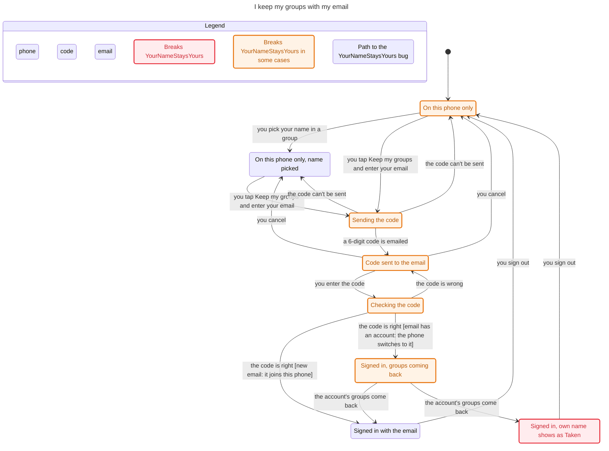

# I keep my groups with my email

What a person sees when they tap "Keep your groups" on the home screen, on one phone: linking an email to this phone, signing in to an account the email already has (for example on a new phone), and signing out. Code: `components/home/AccountSheet.tsx`, `sync/accountMachine.ts` and `sync/accountStore.ts`, and the email steps in `backend/supabaseBackend.ts`, all under `src/features/group-ledger/`.

## What each state means for the person

| State                              | What they see and what it means                                                                                                                                                       |
| ---------------------------------- | ------------------------------------------------------------------------------------------------------------------------------------------------------------------------------------- |
| On this phone only                 | "Keep your groups". The phone is an anonymous user: its groups live on this phone and the server knows it only by that user.                                                          |
| On this phone only, name picked    | The same, and in some group they have picked which member they are.                                                                                                                   |
| Sending the code                   | They entered an email. A new email is attached to this phone's user; an email that already has an account gets a sign-in code instead.                                                |
| Code sent to the email             | The sheet asks for the 6-digit code. Cancel goes back with nothing changed.                                                                                                           |
| Checking the code                  | The code is with the server. A wrong one asks again.                                                                                                                                  |
| Signed in with the email           | "Your account". For a new email, nothing else changed: same user, same groups, same names. Each time the app opens signed in, it looks for groups the account joined on other phones. |
| Signed in, groups coming back      | The email had an account, so the phone is now that account's user. Its groups are being added to this phone; the phone's own groups stay and are rejoined with their invite codes.    |
| Signed in, own name shows as Taken | Signed in, but in a group where they picked their name before signing in, that name now belongs to the anonymous user they were, and the group asks "Who are you?" again.             |

Signing out makes the phone a new anonymous user. It keeps every group, and the names picked while signed in stay with the account: signing in again brings them back.

## Hidden steps

- Picking a name while signed in is not drawn: the name belongs to the account and survives sign-out and sign-in.
- Every tab of the phone shares one session. A tab that did not sign in learns of it the next time it syncs a group (`accountStore.adopt`). The full model in `formal/identity/` checks that once a tab has seen the session, the changes it sends go out as the "you" it shows.
- Finding the account's groups needs a signal. With none, they come back the next time the app opens signed in.

## Which rule breaks where

Rule `YourNameStaysYours`: "The name you picked in a group stays yours; it is never held by a user no phone is any more." It breaks in "Signed in, own name shows as Taken" (red). The orange states are where it can already be broken in some runs, because a stranded name stays stranded after signing out. The shortest path, as the report numbers it:

0. On this phone only
1. you pick your name in a group
2. you tap Keep my groups and enter your email
3. a 6-digit code is emailed
4. you enter the code
5. the code is right [email has an account: the phone switches to it], and the account's groups come back

This is the design today (`docs/GROUP-LEDGER.md`: an email that has an account signs the phone in to it and rejoins its groups by invite code). The groups move to the account; the names picked as the anonymous user do not. Linking a new email does not have this problem, because the user stays the same. Fixing it is a product decision: carry the anonymous user's picks over on sign-in, or merge the two users on the server.

The chart comes from `formal/flows/account/Account.tla` and its view; run the pstack `/statechart` skill on `Account.tla` with `Account.cfg` and `view.mjs` to draw it again.
