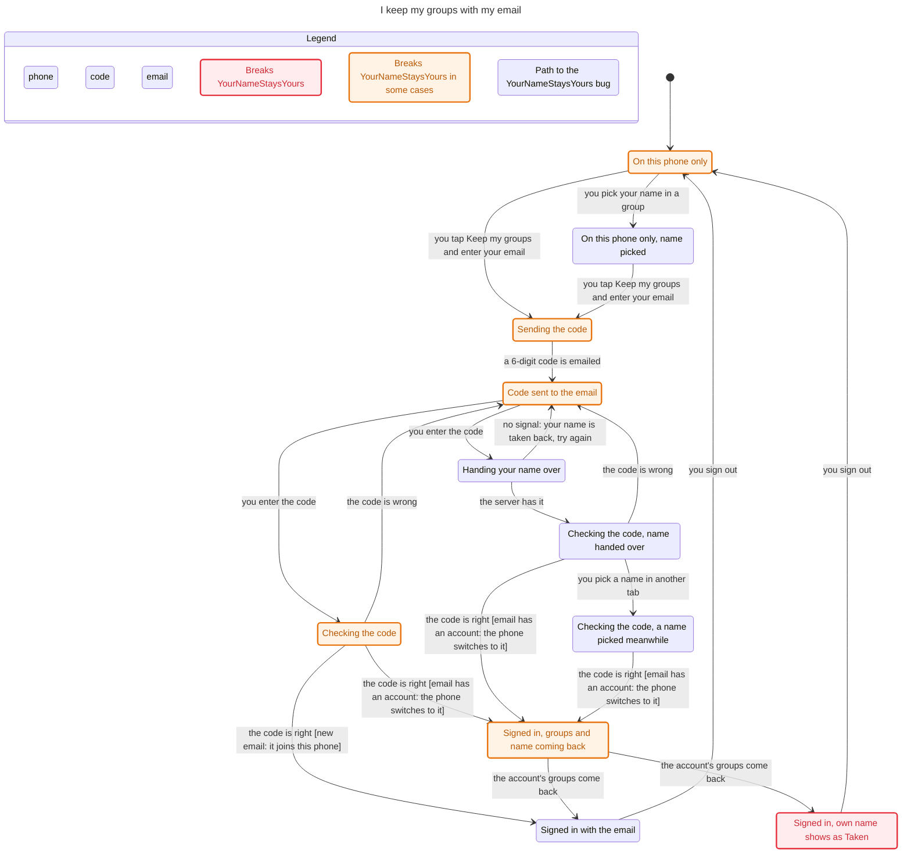

# I keep my groups with my email

What a person sees when they tap "Keep your groups" on the home screen, on one phone: linking an email to this phone, signing in to an account the email already has (for example on a new phone) with the name they picked carried over, and signing out. Code: `components/home/AccountSheet.tsx`, `sync/accountMachine.ts`, `sync/accountStore.ts` (`verifyEmailCode`), `sync/carryNames.ts`, and the email steps in `backend/supabaseBackend.ts`, all under `src/features/group-ledger/`.

## What each state means for the person

| State                                      | What they see and what it means                                                                                                                                                                 |
| ------------------------------------------ | ----------------------------------------------------------------------------------------------------------------------------------------------------------------------------------------------- |
| On this phone only                         | "Keep your groups". The phone is an anonymous user: its groups live on this phone and the server knows it only by that user.                                                                    |
| On this phone only, name picked            | The same, and in a group they have picked which member they are.                                                                                                                                |
| Sending the code                           | They entered an email. A new email is attached to this phone's user; an email that already has an account gets a sign-in code instead.                                                          |
| Code sent to the email                     | The sheet asks for the 6-digit code.                                                                                                                                                            |
| Checking the code                          | The code is with the server. A wrong one asks again.                                                                                                                                            |
| Handing your name over                     | Signing in to an existing account with a name picked: before the code is checked, the phone gives the name up as the user it is now, and waits for the server to take that.                     |
| Checking the code, name handed over        | The name is free for a moment. If the code is wrong, the phone picks it back as the same user.                                                                                                  |
| Checking the code, a name picked meanwhile | While the code was checked, they picked a name in another tab of this phone, as the user they are about to leave.                                                                               |
| Signed in, groups and name coming back     | The phone is now the account's user. The account's groups are added; then the handed-over name is picked again, as the account, unless the account already has a name in that group.            |
| Signed in with the email                   | "Your account". For a new email nothing else changed: same user, same groups, same names. When the account already had a name in the group, it keeps that one and the handed-over name is free. |
| Signed in, own name shows as Taken         | A name was left with the anonymous user they were, and the group asks "Who are you?" again with it shown as Taken.                                                                              |

Signing out makes the phone a new anonymous user. It keeps every group, and the names picked while signed in stay with the account: signing in again brings them back.

## Hidden steps

- The code can't be sent, and cancelling: both go back to where the person started, from any state before the code is checked.
- Picking a name while signed in: it belongs to the account and survives sign-out and sign-in.
- A wrong code after a name was picked meanwhile: it goes back to "Code sent to the email", like the other wrong-code arrows.
- Every tab of the phone shares one session. A tab that did not sign in learns of it the next time it syncs a group. The full model in `formal/identity/` checks that once a tab has seen the session, the changes it sends go out as the "you" it shows.

## Which rule breaks where

Rule `YourNameStaysYours`: "The name you picked in a group stays yours; it is never held by a user no phone is any more." Handing the name over before the switch keeps it in the plain case (since `6ff0a07`). It still breaks in "Signed in, own name shows as Taken" (red), reached only through "Checking the code, a name picked meanwhile". The orange states are where it can already be broken in some runs, because a stranded name stays stranded after signing out. The shortest path, as the report numbers it:

0. On this phone only
1. you pick your name in a group
2. you tap Keep my groups and enter your email
3. a 6-digit code is emailed
4. you enter the code: Handing your name over
5. the server has it: Checking the code, name handed over
6. you pick a name in another tab: Checking the code, a name picked meanwhile
7. the code is right [email has an account: the phone switches to it], and the account's groups come back

`carryNames.release` reads the names once, when the code is entered, so a name picked in another tab after that is not carried. The group tab shows "Who are you?" as soon as the name is handed over, which invites exactly this. The full model also finds that `reclaim` can move the account off a name it picked on another phone in the same moment; see `.agents/skills/identity-model/SKILL.md`.

The chart comes from `formal/flows/account/Account.tla` and its view; run the pstack `/statechart` skill on `Account.tla` with `Account.cfg` and `view.mjs` to draw it again.
