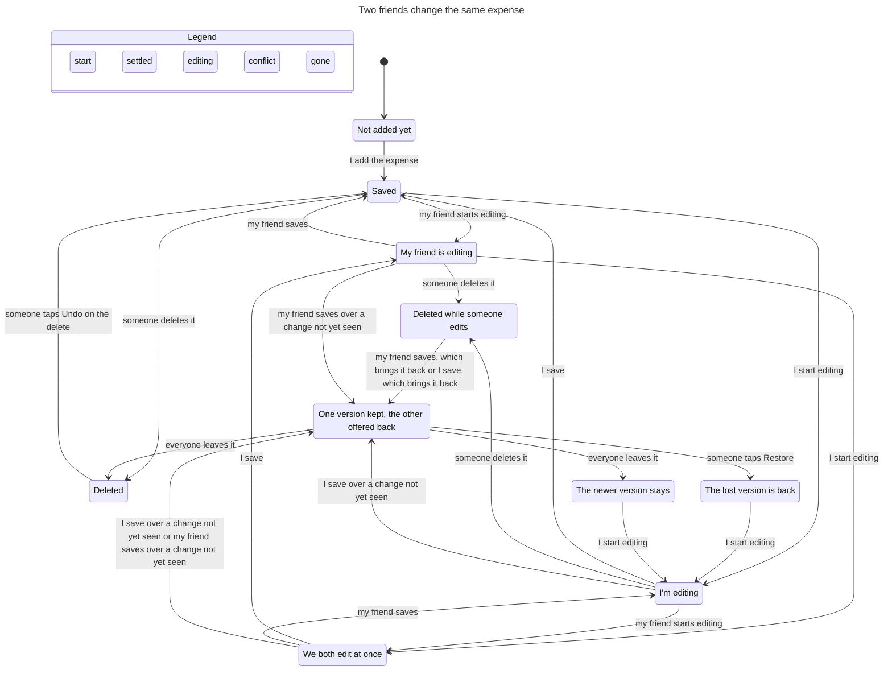

# Two friends change the same expense

How one expense moves when two people change it from their own phones, from the user's view. Drawn from a small TLA+ model of `stepEntry` (`src/features/group-ledger/logic/entryLifecycle.ts`), the Restore button on a replaced activity row (`components/activity/ActivityScreen.tsx`) and the Undo on the delete toast. TLC checked every path the model allows; both rules below hold.

## What each state means

| State                                    | Meaning                                                                                                                                                                                                    |
| ---------------------------------------- | ---------------------------------------------------------------------------------------------------------------------------------------------------------------------------------------------------------- |
| Not added yet                            | Nobody has saved the expense.                                                                                                                                                                              |
| Saved                                    | Everyone sees one version, and nobody has it open in the editor.                                                                                                                                           |
| I'm editing / My friend is editing       | One person has the editor open on the version they saw when they opened it.                                                                                                                                |
| We both edit at once                     | Both have the editor open, each on the version they saw.                                                                                                                                                   |
| Deleted                                  | The expense is gone from the list. The delete toast offers Undo.                                                                                                                                           |
| Deleted while someone edits              | Someone deleted it while the other still had it open in the editor.                                                                                                                                        |
| One version kept, the other offered back | A save landed on a version its author never saw. The later save wins the whole expense. The activity list shows "Replaced a change made at the same time" with the version that lost and a Restore button. |
| The lost version is back                 | Someone tapped Restore. The version that lost is the expense again.                                                                                                                                        |
| The newer version stays                  | Nobody tapped Restore. The row stays in the activity list, so Restore is still there later.                                                                                                                |

## Steps the chart does not show

- **Syncing.** Phones pull and push in the background. The model treats each phone as up to date when it starts something. What goes stale is the version on screen while the editor is open, which is the `base` the save carries.
- **Steps that stay in one state.** For example, a save while a conflict is already offered stays in "One version kept, the other offered back".
- **Arrows that repeat others.** Undo on a delete while someone is mid-edit. Out of "The lost version is back" and "The newer version stays", every step except "I start editing", because those steps repeat what "Saved" shows.

## Rules

- **No change is lost silently.** Every save or delete anyone made is what everyone sees now, or someone who had it on screen changed it, or it is in the activity list with a way back. This rule holds. If the code did not flag a save over a delete, the rule would break in 4 steps: I add the expense, my friend starts editing, someone deletes it, my friend saves, which brings it back. Nobody would be told that the delete was undone. `pnpm formal:ledger:mutants` breaks the real code the same way and checks that the property suite catches it.
- **Restore brings back the version that lost.** This rule holds.

When a save brings back a deleted expense, Restore on that row puts back the version from before the delete. It does not delete the expense again. Undo on the same row deletes it again.

## What the model leaves out

The model has one expense, two people, at most 4 writes and one conflict at a time. Restore and "leave it" happen once nobody is mid-edit. It does not model member merges, claims, balances, or a phone that stays offline across several conflicts. The property suite in `src/features/group-ledger/logic/fold.properties.test.ts` checks those on the real code (see the `ledger-model` skill).

## Make the chart again

The model is in `.agents/skills/ledger-model/statechart/`: `conflicts.tla`, `conflicts.cfg` and the labels in `view.mjs`. Run it with the pstack `/statechart` skill, giving it `conflicts.tla`, `--config conflicts.cfg`, `--view view.mjs` and a new `--out` folder outside the repo, then paste the new `chart.mmd` above.
