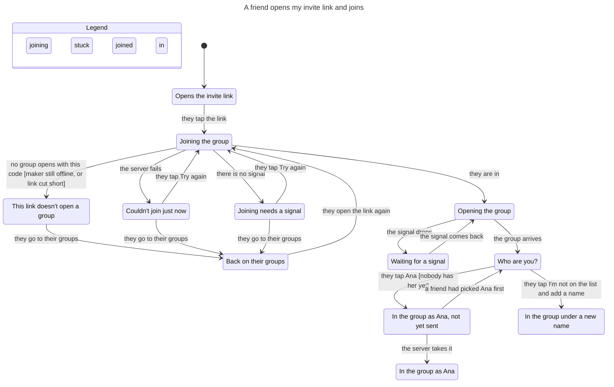

# A friend opens my invite link and joins

What a friend sees from tapping an invite link on a phone that has never opened the group, to being in it under a name. Code: `hooks/useJoinGroup.ts` with `logic/joinState.ts` (the join screen), `components/group/gateScreen.ts` (the screen in front of every group), and `components/group/WhoAreYou.tsx` with `logic/fold.ts` (picking a name), all under `src/features/group-ledger/`.

## What each state means for the friend

| State                             | What they see and what it means                                                                                                                      |
| --------------------------------- | ---------------------------------------------------------------------------------------------------------------------------------------------------- |
| Joining the group                 | A spinner. The phone asks the server to add it to the group the code opens. On a phone that has never used Split, this also signs it in anonymously. |
| This link doesn't open a group    | No group has this code. Either the link was cut short, or the maker made the group with no signal and their phone has not put it on the server yet.  |
| Couldn't join just now            | The server failed. "Try again" asks once more.                                                                                                       |
| Joining needs a signal            | Joining is the one step that needs a signal. Once joined, the group works offline.                                                                   |
| Back on their groups              | They left the join screen. The link can be opened again later.                                                                                       |
| Opening the group                 | Joined: the group is on this phone, and its changes are on their way down.                                                                           |
| Waiting for a signal              | Joined, but the group's first change has not arrived and the phone is offline.                                                                       |
| Who are you?                      | The group is open. They pick their name from the members nobody has picked, or add their own.                                                        |
| In the group as Ana, not yet sent | The phone shows them as Ana at once. Their pick is still on its way to the server.                                                                   |
| In the group as Ana               | The server took the pick: Ana is theirs.                                                                                                             |
| In the group under a new name     | They added a name nobody had, so no one can take it from them.                                                                                       |

## Hidden steps

- The maker's phone coming back online, which puts a group made offline on the server. It changes no screen, so the chart does not draw it: after it, "they open the link again" leads to "they are in".
- The anonymous sign-in on a brand-new phone happens inside "Joining the group". Since `60cbbe2` a phone makes one anonymous user even when two of its tabs start at once (a Web Lock in `supabaseBackend.ts`).
- Opening a link to a group this phone already holds skips straight to the group, with or without a signal. The chart starts from a phone that does not hold it.
- The chart hides the end steps that change nothing ("done" in "Back on their groups" and the two "In the group" states).

## Which rule breaks where

Rule: "They are never in the group as a name the server gave a friend first" holds. Two friends can tap Ana at the same moment: both phones show "In the group as Ana, not yet sent", the server keeps the first pick, and the other friend goes back to "Who are you?" with Ana shown as taken.

Two things the full model in `formal/identity/` found, outside this one-friend chart:

- If the friend later signs in to an email that already has an account, Ana is handed over to that account. A name picked in another tab while the code is being checked is not, and stays with the anonymous user they were. See `docs/flows/account.md`.
- If, during one sync of the group, another tab of the phone signs in to an account and then signs out, the group can say "This link stopped working" though the link works, until the phone next syncs that group.

The chart comes from `formal/flows/join/Join.tla` and its view; run the pstack `/statechart` skill on `Join.tla` with `Join.cfg` and `view.mjs` to draw it again.
