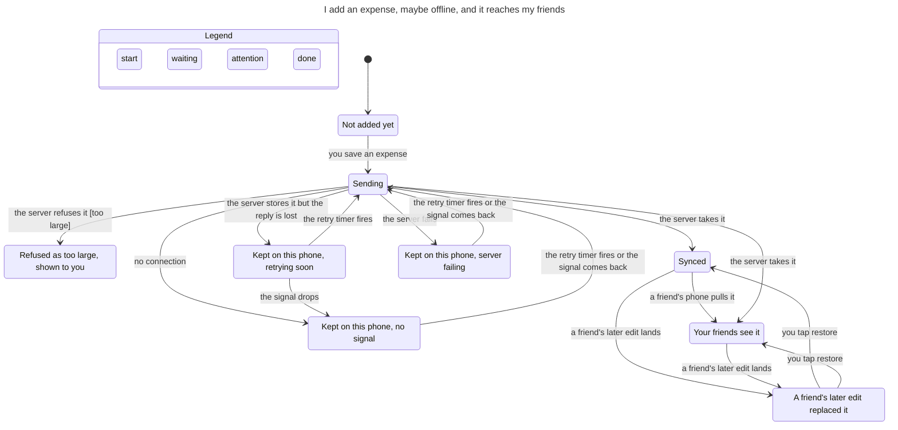

# Adding an expense, and how it reaches your friends

What happens to one expense Ana saves in a group, from the moment she taps Save until her friends see it, with or without signal. The chart is drawn from a small TLA+ model checked with TLC (34 states), in [sync-chart/](sync-chart/). The engine it describes is `src/features/group-ledger/sync/syncMachine.ts`; the full model of the engine, with tabs, phones and the server's rules, is in [formal/sync/](../../formal/sync/README.md).



## What each state means for you

| State                              | What you see and what is true                                                                                                                                                                                                                  |
| ---------------------------------- | ---------------------------------------------------------------------------------------------------------------------------------------------------------------------------------------------------------------------------------------------- |
| Not added yet                      | Nothing saved.                                                                                                                                                                                                                                 |
| Sending                            | The expense is already stored on this phone and counted as pending. A sync run is pushing it.                                                                                                                                                  |
| Kept on this phone, no signal      | The push found no connection. The expense stays pending on this phone and in the balances you see; the badge reads "Saved on this phone · 1 waiting". It goes again when the signal comes back or on the retry timer (2 s, doubling to 1 min). |
| Kept on this phone, retrying soon  | The server may already hold it, but the reply never arrived. It is sent again; the server keeps one copy of each op, so this never makes a duplicate.                                                                                          |
| Kept on this phone, server failing | The server failed the push. The run still pulls your friends' changes, and the badge reads "Some changes can't sync · 1 kept on this phone". The expense stays queued for the retry timer.                                                     |
| Synced                             | The server has it at its place in the group's log, and this phone holds it as confirmed.                                                                                                                                                       |
| Your friends see it                | A friend's phone pulled it, after a realtime poke or when the friend opened the group.                                                                                                                                                         |
| Refused as too large, shown to you | The server will never take it (over 64 KB). It is removed from the phone so it does not block the changes behind it, and listed as rejected.                                                                                                   |
| A friend's later edit replaced it  | A friend edited the same expense, maybe offline, and their change reached the server after yours, so it wins. The activity list says so and offers a one-tap restore.                                                                          |

## Rules checked

All five hold in every one of the 34 states:

- **Never lost.** The expense is on your phone or on the server, unless the server refused it.
- **Once on the server.** A resend after a lost reply never stores a second copy.
- **A refusal is shown.** An expense the server refused is listed, not dropped silently.
- **Friends see only what the server has.**
- **Synced means on the server.**

## What the chart hides or leaves out

- Steps that change nothing you can see: the signal dropping while nothing is pending, the signal coming back while sending, and a friend pulling the expense while you still see it as pending (it then shows as "Your friends see it" once your own phone confirms it, the `Sending → Your friends see it` arrow).
- The steps inside one sync run: asking for the session, joining the group, the push batches and the pull pages. The full engine model in `formal/sync/` checks those.
- Opening the group on a second tab of the same phone. The full model found a bug there, fixed in e215b90: two tabs confirming at once could leave the phone showing an older log, missing even your own synced expense, until the next sync. In this chart that would be a step from "Synced" back to an earlier state; with the fix it cannot stick.
- Being locked out because the invite link opens nothing yet, a crash or reload of the tab (the expense survives it: it was stored before Save returned), and a phone whose storage is full.

To draw it again, from the repo root, with the pstack `/statechart` skill:

```sh
<statechart skill>/scripts/statechart docs/flows/sync-chart/AddExpense.tla \
  --config docs/flows/sync-chart/AddExpense.cfg --view docs/flows/sync-chart/view.ts --out /tmp/sync-chart
```
